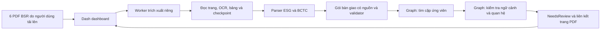

# ESG Tracker: Extract → Knowledge Graph

Một repository chứa giao diện tải báo cáo PDF, bộ trích xuất dữ liệu ESG/BCTC và bộ đối chiếu Knowledge Graph. Mục tiêu hiện tại là phân tích sáu báo cáo BSR: một ESG và một BCTC **hợp nhất** cho từng năm 2023, 2024, 2025.

Kết quả `NeedsReview` nghĩa là **cần người kiểm tra nguồn**. Chênh lệch số và dữ liệu do OCR đọc chưa phải kết luận mâu thuẫn hoặc greenwashing. Một bản clone mới chỉ chứa mã nguồn, cấu hình, schema và tài liệu; không chứa PDF hoặc kết quả đã chạy trên máy tác giả.

## Kiến trúc



| Thành phần | Vị trí | Vai trò |
| --- | --- | --- |
| Giao diện | `app.py`, `dashboard/` | Tải PDF, hiển thị tiến độ, dữ liệu trích xuất và các cặp cần duyệt |
| Extract | `src/extraction/`, `scripts/` | Đọc PDF theo trang, OCR, nhận diện bảng, trích ESG/BCTC, lưu nguồn |
| Hợp đồng dữ liệu | `contracts/`, `knowledge_graph/schemas/` | Kiểm tra cấu trúc gói bàn giao và dữ liệu Graph |
| Knowledge Graph | `knowledge_graph/kg/`, `knowledge_graph/tools/` | Tìm cặp ESG–BCTC, kiểm tra năm đo/phạm vi/đơn vị và tạo kết quả cần duyệt |
| Cấu hình | `config/`, `knowledge_graph/data/config/` | Quy tắc Extract và hồ sơ đối chiếu BSR |
| Tài liệu và kiểm tra | `docs/`, `knowledge_graph/docs/`, hai thư mục `tests/` | Hướng dẫn từng phần và kiểm tra mã nguồn |

Các công cụ chính: **Python 3.12**, **Dash/Flask** cho giao diện, **Docling**, **PyMuPDF**, **pdfplumber** và **RapidOCR** cho PDF/OCR, **JSON Schema** cho kiểm tra dữ liệu, **RDFLib** và **pySHACL** cho phần Graph. Danh sách phiên bản nằm trong [`requirements.txt`](requirements.txt); phần Graph cũng có [`knowledge_graph/requirements.txt`](knowledge_graph/requirements.txt).

## Cài đặt và chạy trên Windows

```powershell
git clone https://github.com/ducmanh9898-sudo/esg_tracker.git
cd esg_tracker
py -3.12 -m venv .venv
.\.venv\Scripts\python.exe -m pip install -r requirements.txt
.\.venv\Scripts\python.exe -B app.py
```

Mở <http://127.0.0.1:8050>. Lần cài đầu cần Internet để tải thư viện và có thể cần tải mô hình OCR. Ứng dụng mặc định chạy trên máy cá nhân. Tắt bằng **Ctrl+C** trong cửa sổ PowerShell.

## Chạy luồng BSR từ giao diện

1. Chọn **6 PDF trong cùng một lần upload**: ESG 2023–2025 và BCTC hợp nhất 2023–2025.
2. Để **Năm báo cáo** trống và **Loại báo cáo** là **Tự nhận diện** khi tệp có tên thể hiện năm và loại; kiểm tra lại thông tin nhận diện trước khi tin kết quả.
3. Bấm **Trích xuất và phân tích**. Giao diện cho biết tài liệu, trang và bước đang chạy. Sau Extract, ứng dụng tự tạo gói bàn giao và gọi Graph nếu sáu nguồn hợp lệ.
4. Vào **Đối chiếu BSR → Phiên upload hiện tại** để mở từng cặp, xem nguyên văn và PDF nguồn. Nếu Graph bị bỏ qua hoặc lỗi, lý do hiển thị trên trang upload và mục đối chiếu.

Các tệp do lần chạy tạo ra nằm dưới `data/uploads/`, `data/processed/` và `knowledge_graph/output/`. Chúng được bỏ qua khi commit. Lịch sử cũ không tự có trên máy mới.

## Quy tắc của kết quả

- Extract giữ trang vật lý, câu nguồn, giá trị và trạng thái chưa xác minh. OCR có thể sai.
- Graph phân biệt năm báo cáo với năm đo; không tự coi chỉ tiêu khác định nghĩa, đơn vị hoặc phạm vi là mâu thuẫn trực tiếp.
- `NeedsReview` là cặp ứng viên cần đối chiếu với PDF. Hệ thống chưa có luồng nhập quyết định của người duyệt trở lại Graph.
- Một lần chạy thành công về kỹ thuật không bảo đảm đã tìm hết mọi chỉ tiêu hoặc có kết luận kiểm toán.

## Hướng dẫn thêm

- [Luồng Extract và cấu trúc gói bàn giao](docs/EXTRACT_BATCH_UPGRADE.md)
- [Bảng NeedsReview trong giao diện](docs/GRAPH_REVIEW_DASHBOARD.md)
- [Hướng dẫn Graph](knowledge_graph/README.md)
- [Hợp đồng giữa Extract và Graph](knowledge_graph/docs/extract-graph-contract.md)

Không đưa PDF, khóa truy cập, cơ sở dữ liệu làm việc hoặc dữ liệu xử lý lên Git. Các ví dụ cấu hình chứa đường dẫn nguồn phải được chỉnh cho máy và PDF của bạn.
