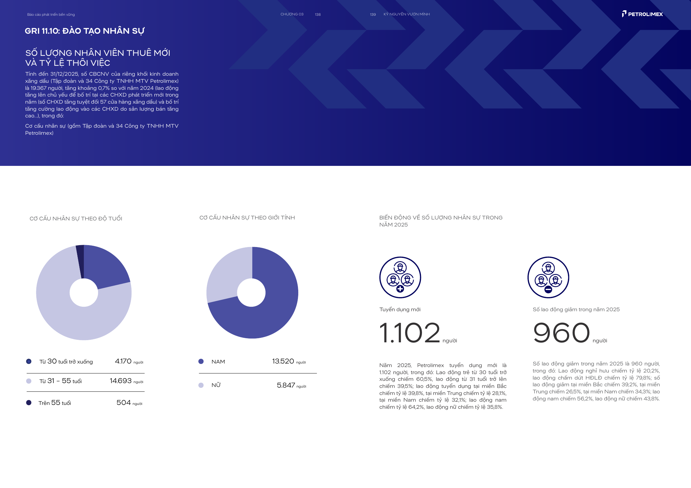

# Bộ ca chờ review trên corpus thật — KG-E-01, KG-S-01, KG-G-01

**Ngày lập:** 2026-10-09. **Phạm vi:** sáu nhóm measurement thật, tối đa hai nhóm mỗi rule, thuộc BSR, PLX và PVD. Đây là **bộ ca đề xuất chờ người review**, chưa phải gold set. Nhãn kỳ vọng bên dưới được xác định từ bảng nguồn, annotation hiện có và guard trong [Rule Catalogue](../rules-demo.md), trước bước đối chiếu engine. `Supported` nếu nêu ở dạng điều kiện chỉ có nghĩa phép kiểm tra số học đạt sau khi mọi guard được xác nhận; không phải trạng thái hiện được duyệt.

Các liên kết `page_text` trỏ tới bản trích trang trong repository để người review mở lại được; JSON Extract và normalized claim đều giữ `source_file`, `source_pages`, JSON Pointer và evidence ID. Với BSR, URL PDF chính thức được công cụ tìm kiếm lập chỉ mục nhưng lần mở trực tiếp trả lỗi 502; bằng chứng đang truy cập được trong workspace là trang trích, cần mở PDF khi duyệt nguồn. Với PLX và PVD, có locator PDF do doanh nghiệp công bố. `original_text` trong normalized evidence của các ca dưới đây vẫn là `null`; việc đọc trang trích cho hồ sơ này **không** tự đổi source review của pipeline.

## KG-E-01: Tổng Scope 1 + Scope 2

### REAL-E-PVD-2025

| Trường | Nội dung |
| --- | --- |
| Công ty, report ID, kỳ | PVD; `PVD:2025:ESG:unknown:PVD_2025_esg.json`; năm báo cáo/kỳ đo 2025, `period_type=annual` |
| Claim ID và vai trò | Scope 1 `CLM-70A80557DE7FCAFE` = **2.692**; Scope 2 `CLM-79B1E351ACE5A99B` = **1.719**; tổng `CLM-6F6DEE155D4FF538` = **4.411**. Đơn vị ở bảng nguồn: tấn CO₂e; normalized `unit=null`. |
| Bằng chứng truy cập | [Trang trích PVD 2025](../../data/source/page_text/PVD_2025.json), `pages[page_number=127]`, phụ lục 3, hàng E2.1–E2.3, cột 2025; trang in 252–253. [PDF PVD 2025](https://www.pvdrilling.com.vn/Data/Sites/1/media/qhcd/phattrienbenvung/BCPTBV%202025%20WEB%20FINAL_20260423.pdf), trang PDF vật lý 127. JSON nguồn [PVD_2025_esg.json](../../data/extract/esg/PVD_2025_esg.json), các pointer `/environment/ghg_emissions/scope_1_tco2e/2025`, `/scope_2_tco2e/2025`, `/scope_1_and_2_tco2e/2025`. |
| Guard có căn cứ | Bảng ghi rõ tổng **Phạm vi 1 & 2**, ba dòng cùng cột 2025 và cùng đơn vị in; `2.692 + 1.719 = 4.411` theo số hiển thị. Tổng là số công bố, không phải tổng tự tạo. |
| Guard còn thiếu | Ba source review và canonical mapping còn pending; `original_text` chưa vào normalized evidence. Boundary/scope tổ chức, gross/net, phương pháp Scope 2 và căn cứ precision chưa được xác minh; không suy từ cùng bảng rằng mọi guard đã đạt. |
| Kỳ vọng đề xuất / review | **NeedsReview**: số học khớp nhưng chưa đủ review nguồn, mapping và context. Nếu các guard được người review xác nhận, phép tính có thể **Supported**. Chưa ai duyệt ca này. |

### REAL-E-PLX-2025

| Trường | Nội dung |
| --- | --- |
| Công ty, report ID, kỳ | PLX; `PLX:2025:ESG:unknown:PLX_2025_esg.json`; năm báo cáo/kỳ đo 2025, `period_type=annual` |
| Claim ID và vai trò | Scope 1 `CLM-951F9DB3ABA4F5D0` = **146.895,66**; Scope 2 `CLM-0AC8FC20E8880816` = **52.502,59**; tổng `CLM-C899E5F5D395F3F7` = **199.398,25**; normalized `unit=tCO2e`. |
| Bằng chứng truy cập | [Trang trích PLX 2025](../../data/source/page_text/PLX_2025.json), `pages[page_number=50]`, trang in 98–99; [trang doanh nghiệp PLX](https://petrolimex.com.vn/bcptbv-2025.html) nêu cả ba số và [PDF PLX 2025](https://files.petrolimex.com.vn/files/6783dc1271ff449e95b74a9520964169/application%3Dpdf/f7544d67596046169c12cfa96afdc1e1/PLX%20BC%20PTBV%202025%20TV%200106.pdf). JSON nguồn [PLX_2025_esg.json](../../data/extract/esg/PLX_2025_esg.json), nhóm `/environmental/greenhouse_gas_emissions/`, các mục `scope_1_direct`, `scope_2_indirect`, `total_operational_emissions_scope_1_and_2`. |
| Guard có căn cứ | Văn bản ghi rõ tổng Scope 1 & 2 và từng thành phần cho 2025, cùng đơn vị tCO₂tđ; `146.895,66 + 52.502,59 = 199.398,25` theo số công bố. |
| Guard còn thiếu | Source/mapping chưa được người review xác nhận; normalized `scope=null`, boundary `unknown`, original text `null`. Chưa có xác nhận gross/net, phương pháp Scope 2, phạm vi tổ chức và precision/rounding của nguồn. |
| Kỳ vọng đề xuất / review | **NeedsReview**: phép cộng khớp nhưng guard review và comparability chưa đủ. Nếu xác nhận đầy đủ, phép kiểm tra số học có thể **Supported**. Chưa ai duyệt ca này. |

## KG-S-01: Lao động nữ ≤ tổng lao động

### REAL-S-BSR-2025

| Trường | Nội dung |
| --- | --- |
| Công ty, report ID, kỳ | BSR; `BSR:2025:ESG:unknown:BSR_2025_esg.json`; năm báo cáo/kỳ quan sát 2025, `period_type=annual` chưa verified |
| Claim ID và vai trò | Nữ `CLM-B7EB563E51B8` = **214 người**; tổng `CLM-08082F5B81CD` = **1.594 người**. Normalized `scope=reported_workforce`, boundary `unknown`. |
| Bằng chứng truy cập | [Trang trích BSR 2025](../../data/source/page_text/BSR_2025.json), `pages[page_number=39]`, trang in 77: bảng “Quy mô lao động”, cột 2025. JSON nguồn [BSR_2025_esg.json](../../data/extract/esg/BSR_2025_esg.json), pointer `/social/workforce/female_employees_reported` và `/social/workforce/total_employees`. [Locator PDF BSR 2025](https://bsr.com.vn/c/document_library/get_file?download=true&groupId=37629&uuid=f9f89a31-e74d-7033-9a29-7429ff516c82); chưa mở được PDF trong lần này. |
| Guard có căn cứ | Nữ và tổng nằm trong cùng bảng quy mô lao động, cùng cột 2025, cùng đơn vị “Người”; `214 ≤ 1.594`. |
| Guard còn thiếu | Chưa xác nhận ngày chốt, cách đếm/headcount, quần thể và boundary tổ chức; source/mapping pending, original text chưa vào normalized. Bảng cũng ghi nam **1.353**, nên nam+nữ = **1.567**, ít hơn tổng **27**; cần xem PDF gốc và giải thích coverage/OCR. Chênh lệch này không phải phép kiểm tra KG-S-01 và không tự thành Contradicted. |
| Kỳ vọng đề xuất / review | **NeedsReview** vì context và source còn thiếu, dù bất đẳng thức hiển thị đạt. Chưa ai duyệt ca này. |

### REAL-S-PLX-2025

| Trường | Nội dung |
| --- | --- |
| Công ty, report ID, kỳ | PLX; `PLX:2025:ESG:unknown:PLX_2025_esg.json`; năm báo cáo/kỳ quan sát 2025, nguồn ghi snapshot **31/12/2025** |
| Claim ID và vai trò | Nữ `CLM-6D11DAA742C071EE` = **5.847 người**; tổng `CLM-63C08488CE814480` = **19.367 người**; normalized `unit=null`, boundary `unknown`. |
| Bằng chứng truy cập | [PDF PLX 2025](https://files.petrolimex.com.vn/files/6783dc1271ff449e95b74a9520964169/application%3Dpdf/f7544d67596046169c12cfa96afdc1e1/PLX%20BC%20PTBV%202025%20TV%200106.pdf), trang vật lý **70**, trang in **138–139**; [ảnh nguyên trang](plx-2025-workforce-source-p70.png) kết xuất trực tiếp từ PDF; [trang trích](../../data/source/page_text/PLX_2025.json), `pages[page_number=70]`. JSON nguồn [PLX_2025_esg.json](../../data/extract/esg/PLX_2025_esg.json), pointer `/social/workforce_profile/by_gender/female/count` và `/social/workforce_profile/total_employees`. |
| Guard có căn cứ | Đoạn văn ghi 19.367 CBCNV của **riêng khối kinh doanh xăng dầu**, gồm Tập đoàn và 34 Công ty TNHH MTV Petrolimex, tại **31/12/2025**. Ngay sau đó, tiêu đề “Cơ cấu nhân sự” lặp lại phạm vi này; biểu đồ giới tính ghi nữ 5.847 và nam 13.520 **người**. `13.520 + 5.847 = 19.367`; các nhóm tuổi `4.170 + 14.693 + 504 = 19.367`. Hai số có căn cứ cùng quần thể và ngày chốt. |
| Guard còn thiếu | Sáu annotation đề xuất vẫn **pending**. PDF dùng “số CBCNV” và “người”, phù hợp cách đếm số người, nhưng không nêu riêng thuật ngữ headcount/FTE hay quy trình đếm; người review cần xác nhận diễn giải `counting_method=headcount`. Annotation đang dùng chưa chứa source/mapping/context review cho hai claim; normalized hiện có `unit=null`, boundary `unknown`, original text `null`. |
| Kỳ vọng đề xuất / review | **NeedsReview** với annotation đang dùng. Chỉ khi người review xác nhận nguồn, hai mapping, cùng boundary/quần thể/ngày chốt, đơn vị `person` và cách đếm `headcount` trên **cả hai claim**, KG-S-01 mới có thể trả **Supported** cho phép `5.847 ≤ 19.367`. Không suy kết quả này cho toàn bộ lao động hợp nhất. Chưa ai duyệt ca hay sáu annotation đề xuất. |

**Đối chiếu PDF trực tiếp (2026-10-09).** Bản PDF được mở ở trang vật lý 70, có SHA-256 `480e348200bcb298e803c69d3477ccf00f2a261a5847f3273dd2dac53c967232`. Đoạn văn và hai biểu đồ nằm trên cùng trang trải 138–139. Cột bên phải còn có **1.102 tuyển mới** và **960 lao động giảm** trong năm; đó là dòng biến động, không phải quần thể dùng làm mẫu số KG-S-01. Không thấy chú thích riêng trên trang đổi phạm vi của biểu đồ giới tính. `source_pages=[7,70,74]` là locator rộng của Extract được giữ nguyên trong annotation; vị trí đã nhìn thấy trực tiếp cho hai số là **trang 70**.

[Sáu annotation đề xuất theo schema](plx-2025-kg-s-01.pending.json) gồm **2 source, 2 mapping, 2 context**. Chúng giữ claim/report/evidence ID, JSON Pointer, locator rộng của Extract và SHA-256 JSON nguồn `47e7846a4d6bb6db9a7de9816c032d1e489e9433d4d81fd8861301c5c32a6959`. `source_refs.original_text` là đoạn ngắn lấy từ text layer PDF; `review_basis` giải thích từng role và trang. Context đề xuất dùng boundary đúng **khối kinh doanh xăng dầu: Tập đoàn + 34 Công ty TNHH MTV**, cùng `population_id`, snapshot `2025-12-31`, unit `person`, `counting_method=headcount`; hai metric definition khác nhau theo vai trò tổng/nữ. `period_type=annual` là nhóm kỳ trong báo cáo, còn ngày đo là snapshot. Field metadata còn trống ở cả sáu mục: `reviewer`, `reviewed_at`. Diễn giải headcount và toàn bộ nội dung đề xuất vẫn phải được người review xác nhận; file này **không được cấu hình để pipeline áp dụng**.

## KG-G-01: Thành viên độc lập ≤ tổng HĐQT

### REAL-G-PVD-2025

| Trường | Nội dung |
| --- | --- |
| Công ty, report ID, kỳ | PVD; `PVD:2025:ESG:unknown:PVD_2025_esg.json`; năm báo cáo/kỳ quan sát 2025; ngày chốt HĐQT chưa xác định |
| Claim ID và vai trò | Độc lập `CLM-B51DCEBE89BEB022` = **2**; tổng `CLM-D88942EE1564C33B` = **7**; normalized `unit=null`, boundary `unknown`. |
| Bằng chứng truy cập | [Hồ sơ review PVD](pvd-2025-kg-g-01.md) và [ảnh bảng G1](pvd-2025-board-source-p129.png); [PDF PVD 2025](https://www.pvdrilling.com.vn/Data/Sites/1/media/qhcd/phattrienbenvung/BCPTBV%202025%20WEB%20FINAL_20260423.pdf), trang PDF vật lý 129, trang in 256–257; [trang trích](../../data/source/page_text/PVD_2025.json), `pages[page_number=129]`. JSON nguồn [PVD_2025_esg.json](../../data/extract/esg/PVD_2025_esg.json), pointer `/governance/board/independent_members/2025` và `/governance/board/members/2025`. |
| Guard có căn cứ | Cùng bảng G1 cột 2025; `2 ≤ 7`. **Hai source reviews và hai mapping reviews đã được người review xác nhận và pipeline áp dụng** trong [annotation hiện tại](../../data/review/ready_rule_annotations.json). |
| Guard còn thiếu | **Hai context reviews vẫn pending**: cùng board ID được xác minh, ngày chốt, định nghĩa thành viên độc lập, cách đếm, unit và reporting boundary chưa đủ; không suy các yếu tố đó từ cùng năm/bảng. |
| Kỳ vọng đề xuất / review | **NeedsReview** vì context chưa được duyệt; nếu sau review chứng minh mọi guard so sánh, phép tính có thể **Supported**. Người review đã duyệt **source và mapping**, chưa duyệt **context/nhãn ca**. |

### REAL-G-PLX-2025

| Trường | Nội dung |
| --- | --- |
| Công ty, report ID, kỳ | PLX; `PLX:2025:ESG:unknown:PLX_2025_esg.json`; năm báo cáo/kỳ quan sát 2025; trang nguồn ghi snapshot **31/12/2025** |
| Claim ID và vai trò | Độc lập `CLM-A2DECE1C2394B910` = **1**; tổng `CLM-1D31C271632D4213` = **7**; normalized `unit=null`, boundary `unknown`. |
| Bằng chứng truy cập | [Trang trích PLX 2025](../../data/source/page_text/PLX_2025.json), `pages[page_number=19]`, trang in 36–37, mục “Cơ cấu Hội đồng quản trị”; [PDF PLX 2025](https://files.petrolimex.com.vn/files/6783dc1271ff449e95b74a9520964169/application%3Dpdf/f7544d67596046169c12cfa96afdc1e1/PLX%20BC%20PTBV%202025%20TV%200106.pdf). JSON nguồn [PLX_2025_esg.json](../../data/extract/esg/PLX_2025_esg.json), pointer `/governance/board_structure_and_composition/independent_members` và `/total_members`. |
| Guard có căn cứ | Cùng đoạn nguồn: đến 31/12/2025, HĐQT Tập đoàn có 07 thành viên, trong đó 01 thành viên độc lập; `1 ≤ 7`. Đoạn nguồn có nhắc tiêu chí IFC, nhưng chưa coi đó là review định nghĩa cho hai claim. |
| Guard còn thiếu | Source/mapping pending; normalized chưa có board ID, ngày snapshot, định nghĩa, cách đếm, unit hay boundary verified; original text `null`. Cần xác nhận hai số thực sự thuộc cùng HĐQT/thời điểm và ý nghĩa “độc lập”. |
| Kỳ vọng đề xuất / review | **NeedsReview** cho pipeline hiện tại; nếu xác minh các guard, phép tính có thể **Supported**. Chưa ai duyệt ca này. |

## Đối chiếu sau khi khóa nhãn đề xuất

Đọc `output/kg_v2/rule_evaluations.json` và `findings.json` **sau khi** lập sáu nhãn đề xuất ở trên. Ghi kết quả ở đây, không tự đổi nhãn theo engine. Nếu engine cho `Supported` hoặc `Contradicted` khi guard nêu trên chưa duyệt, phải điều tra trước khi dùng ca làm chuẩn.

| Case ID | Kỳ vọng từ bằng chứng và guard | Output engine | Nhận xét |
| --- | --- | --- | --- |
| REAL-E-PVD-2025 | NeedsReview | NeedsReview, `EVAL-A2E7215C22E019E0` | Khớp; nguồn/mapping và context phát thải chưa review. |
| REAL-E-PLX-2025 | NeedsReview | NeedsReview, `EVAL-FA33142F2952E31F` | Khớp; nguồn/mapping và context phát thải chưa review. |
| REAL-S-BSR-2025 | NeedsReview | NeedsReview, `EVAL-A73370FDBD78ED95` | Khớp; quần thể/ngày chốt/cách đếm chưa verified, cần rà soát chênh 27 người trong bảng. |
| REAL-S-PLX-2025 | NeedsReview | NeedsReview, `EVAL-C84445635965FC9F` | Khớp; trang nguồn có snapshot và quần thể, nhưng chưa áp dụng review trên claim. |
| REAL-G-PVD-2025 | NeedsReview | NeedsReview, `EVAL-5DC81C700D3A1C55` | Khớp; source/mapping đã xác nhận, hai context review vẫn pending. |
| REAL-G-PLX-2025 | NeedsReview | NeedsReview, `EVAL-83618E78D41616A4` | Khớp; trang nguồn có snapshot HĐQT, nhưng nguồn/mapping/context chưa review. |

**Đối chiếu:** 6/6 nhóm có đúng các claim ID trong evaluation event và đúng nhãn đề xuất `NeedsReview`; cả 6 event có finding chính tương ứng. Các reason code trong engine khớp các guard còn thiếu nêu ở hồ sơ, nhưng không thay thế việc người review duyệt bằng chứng.

**Bước duyệt:** mở đúng PDF/trang và JSON Extract; xác nhận từng source, mapping và context theo [hướng dẫn annotation](../graph-review-annotations.md). Chỉ sau khi người review chốt bằng chứng và nhãn kỳ vọng mới chuyển ca tương ứng sang gold set. Việc chạy lại pipeline không tự duyệt ca.
